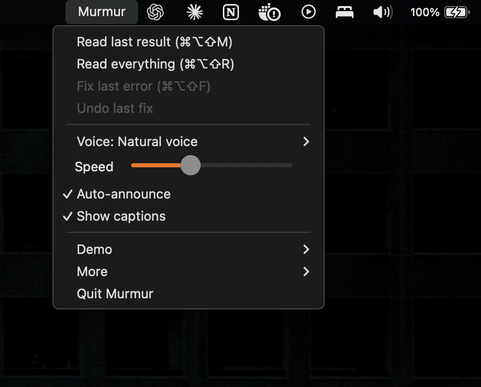
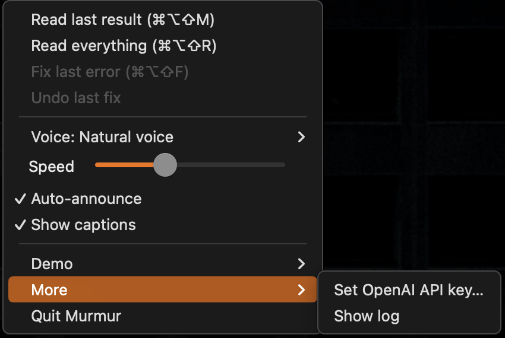
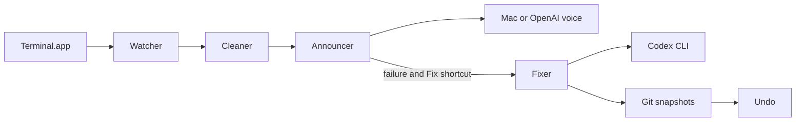

# Murmur

An accessible macOS menu bar companion that turns terminal output into one spoken sentence and helps fix errors with Codex.

Demo video: [Watch on Vimeo](https://vimeo.com/1239318759)

Screen reader users hear terminal output one line at a time: every progress bar, every colour code, every line of a long stack trace. Usually only one line matters, and it’s buried at the bottom. Murmur listens to the terminal for them. When a command finishes, it says what happened in one short sentence, with the exact file, line and cause. If something broke, one shortcut asks Codex to fix it, and another undoes the fix.

**Built with:** Python, rumps, OpenAI (gpt-4o-mini-tts, Marin voice), and Codex CLI for Fix it.

Made for the Codex community hackathon at DevDay Exchange Paris.

## Menu preview

The whole app lives in one menu. Read last result repeats the last announcement. Read everything reads the full output word for word. Fix last error asks Codex to fix it, and Undo last fix reverts it (both stay greyed out until there’s an error or a fix). Voice switches between the fast Mac voice and the natural OpenAI voice. Speed sets how fast it talks. Auto-announce speaks when a command finishes. Show captions puts the spoken text on screen.

Demo holds the offline demo replay and a reset for the demo project. More holds the OpenAI API key (stored in the macOS Keychain) and the log.

## What it does

Murmur reads the front Terminal tab and strips colour, progress and table clutter. Failures include the exact file, line and cause; short successes are read aloud; long ones get a line count. Full output is one shortcut away. VoiceOver gets sounds only. Mac speech is offline; OpenAI needs a key and internet.

## Architecture

## Quick start

On macOS, install uv, then run:

    brew install portaudio
    uv sync
    uv run python -m murmur.app

Set OPENAI_API_KEY in .env for OpenAI speech. Mac speech needs no key. Grant Automation, Accessibility and Input Monitoring to the app running Murmur in System Settings. Fix it needs a logged-in Codex CLI.

## Keys

Double tap Right Command: Space repeats, R reads all, F fixes, U undoes, Escape cancels. Control stops speech. Backups: ⌘⌥⇧M, R and F.

## How Murmur uses Codex

Fix it sends the failure text to Codex CLI. It runs in your Git project with workspace-write access and network disabled for commands. Murmur asks it not to install or commit. Snapshots power Undo, which refuses to overwrite later edits.

## Honest limits

- Only the front Terminal tab is watched; VS Code is not supported yet.
- Success comes from text, not exit codes. OpenAI needs a key and internet. Codex may fail; Undo covers the latest fix only.

## What’s next

VS Code and spoken follow-up questions.

## License

MIT. See LICENSE.
